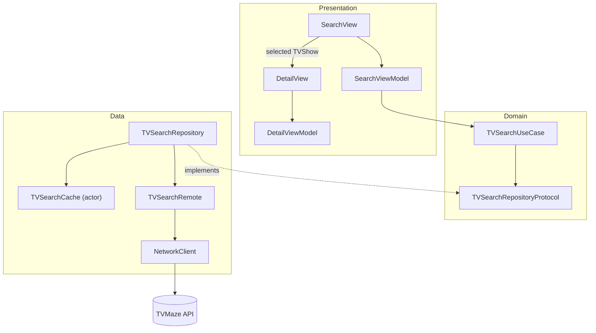

# TVShowExplorer

A SwiftUI app for searching TV shows and viewing their details, using the [TVMaze public API](https://www.tvmaze.com/api). It focuses on clear layering, Swift Concurrency, reliable search cancellation, a time-limited cache and unit tests.

<p align="center">
  
</p>

## Features

- Search by show name with a 450 ms debounce.
- Each new query cancels the previous search and its request. Outdated responses never replace newer results.
- Results list with poster, genres, rating and premiere year. The detail screen adds years on air, channel and summary.
- In-memory cache per query that expires after 3 minutes.
- Recent searches as chips below the search field. A query is saved when you open one of its results (last 5, in memory only).
- Idle, loading, empty and error states, with Retry.

## Tech Stack

- Swift 6 language mode, SwiftUI (`@Observable`, `NavigationStack`)
- Swift Concurrency (`async`/`await`, task cancellation, actors)
- `URLSession`, `Decodable` and XCTest
- No third-party dependencies

## Public API

```
GET https://api.tvmaze.com/search/shows?q={query}
```

TVMaze is free and needs no API key. Each search result already includes every field the detail screen shows, so opening a show makes no extra request.

## Getting Started

Requires **Xcode 27.2** (the project uses the `project.xcproj` format). Deployment target: iOS 18.6.

1. Clone `https://github.com/novecapa/TVShowExplorer.git` and open `TVShowExplorer.xcodeproj`.
2. Select the `TVShowExplorer` scheme and an iPhone simulator.
3. Run the app with ⌘R or the tests with ⌘U.

## Architecture

Three layers inside a single app target:

- **Presentation**: SwiftUI views, `@MainActor` view models and builders that create each screen with its dependencies.
- **Domain**: `TVShow`, `TVSearchRepositoryProtocol` and `TVSearchUseCase`. It depends only on Foundation.
- **Data**: `TVSearchRepository` combines `TVSearchCache` and `TVSearchRemote`, which calls TVMaze through `NetworkClient`. The repository maps DTOs to domain entities.



Dependencies are injected through initializers, so each layer can be tested with mocks.

## Search and Cancellation

`SearchViewModel` keeps at most one search task. Every change to the query cancels it and starts a new one that waits 450 ms before calling the use case, so only the text typed before a pause reaches the network. Cancellation propagates down to `URLSession`, which cancels the in-flight request.

Stale results are blocked without request IDs. The view model is `@MainActor`, and each task checks `Task.isCancelled` right before writing `state`, with no suspension point in between. A response from an older search always finds its task cancelled and is discarded.

## Caching Strategy

`TVSearchCache` is an actor that keeps results in memory per query (trimmed and lowercased) for 3 minutes. Hits skip the network, expired entries are removed when read, and errors are not cached. The clock is injected, so tests check expiration without waiting.

HTTP caching is disabled for API requests (`URLSession.uncached`). TVMaze responses let `URLCache` keep them for an hour, which would bypass the 3-minute expiration.

## Testing

Unit tests in `TVShowExplorerTests` are grouped by layer and use actor-based mocks:

- **Domain**: the use case with a mocked repository.
- **Data**: cache expiration, repository caching and mapping, network error mapping and decoding.
- **Presentation**: view model states, debounce, cancellation, recent searches and detail formatting.

Race-condition tests are deterministic: the mock holds a request in flight and releases it on demand.

## Key Technical Decisions

- **Lightweight Clean Architecture** in one target. Separate modules would add setup without real benefit at this size.
- **Native navigation** with `NavigationStack` and `navigationDestination(for:)` instead of a router, since there is a single search-to-detail flow.
- **Swift Concurrency only**, without Combine or completion handlers.
- **Explicit isolation**: `@MainActor` view models, an actor for the cache and everything else nonisolated by default.

## Development Logging

Debug builds print short logs for network responses, cache hits and cancelled searches (`#if DEBUG` only). The shared scheme sets `OS_ACTIVITY_MODE=disable` to hide system logs in the Xcode console. It also hides `os_log` and `Logger` output, so remove it in **Edit Scheme > Run > Arguments** when you need those logs.

## Scope and Trade-offs

- In-memory cache only, with no size limit. It resets when the app restarts.
- No extra detail request, because the search response has every field needed.
- One generic error message with Retry.

## API Attribution

Data and images are provided by [TVMaze](https://www.tvmaze.com) and licensed under [CC BY-SA 4.0](https://creativecommons.org/licenses/by-sa/4.0/). The detail screen credits TVMaze with a "Data provided by TVmaze" link.
