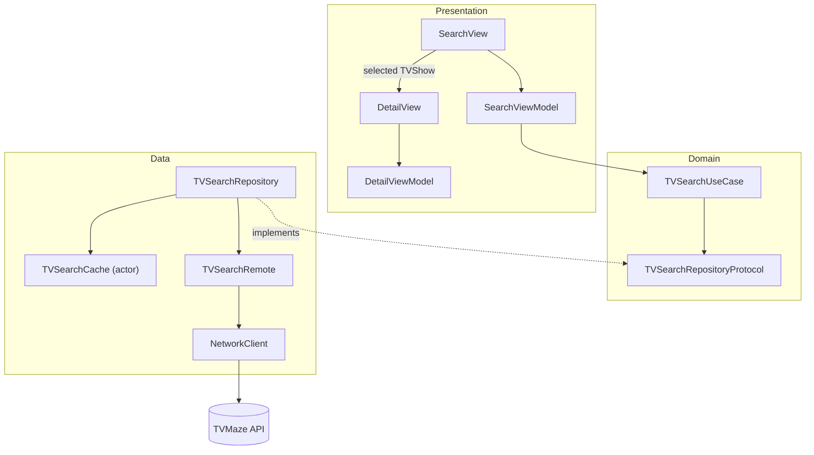

# TVShowExplorer

TVShowExplorer is a SwiftUI app for searching TV shows and viewing their details, using the [TVMaze public API](https://www.tvmaze.com/api).

The app is intentionally small. It focuses on clear separation of responsibilities, Swift Concurrency, reliable search cancellation, a time-limited cache and unit tests.

## Features

- Search TV shows by name from the navigation bar search field.
- Debounced input: a request is sent only after the user pauses typing for 450 ms.
- A new query cancels the previous search, including its in-flight request.
- Responses from outdated searches never replace newer results.
- Results list with poster, name, genres, rating and premiere year.
- Detail screen with poster, title, genres, rating, years on air, channel and summary.
- In-memory cache per query with a 3-minute expiration.
- Idle, loading, results, empty and error states, with a Retry button on errors.

## Tech Stack

- Swift 6 language mode, built with Xcode 27.2.
- SwiftUI (`NavigationStack`, `searchable`, `@Observable`).
- Swift Concurrency: `async`/`await`, `Task` cancellation and actors.
- `URLSession` and `Decodable`.
- XCTest.
- No third-party dependencies.

## Public API

The app uses [TVMaze](https://www.tvmaze.com/api), a free REST API that needs no API key, which makes the project easy to run without any setup.

```
GET https://api.tvmaze.com/search/shows?q={query}
```

The endpoint returns matches ordered by relevance, and each match includes the show's full information. That covers both screens: the detail screen is built from the selected search result, so no second API request is made. Posters are loaded from the image URLs in the response.

## Getting Started

### Requirements

- **Xcode 27.2.** The project uses the `project.xcproj` format (there is no `project.pbxproj`) and has only been verified with this version.
- **iOS 18.6 or later** (deployment target). The test suite has been run on iOS 26.5 and iOS 27.2 simulators.

### Run the app

1. Clone the repository: `git clone https://github.com/novecapa/TVShowExplorer.git`
2. Open `TVShowExplorer.xcodeproj`.
3. Select the `TVShowExplorer` scheme and an iPhone simulator.
4. Press **Run** (⌘R).

Running on a physical device requires selecting your own team under **Signing & Capabilities**.

### Run the tests

In Xcode, press **Test** (⌘U). From the command line:

```bash
xcrun simctl list devices available   # pick an iPhone simulator name
xcodebuild test \
  -project TVShowExplorer.xcodeproj \
  -scheme TVShowExplorer \
  -destination 'platform=iOS Simulator,name=<simulator name>'
```

## Architecture

The code is organised in three layers inside a single app target, one folder per layer:

- **Presentation**: SwiftUI views and `@MainActor` view models. `SearchViewModel` exposes a single `State` enum that `SearchView` renders, and `DetailViewModel` formats the selected show for display. `SearchViewBuilder` and `DetailViewBuilder` create each screen with its dependencies.
- **Domain**: the `TVShow` entity, the `TVSearchRepositoryProtocol` contract and `TVSearchUseCase`. It depends only on Foundation.
- **Data**: `TVSearchRepository` implements the domain contract by combining `TVSearchCache` and `TVSearchRemote`. The remote data source calls TVMaze through `NetworkClient`, which builds the request, maps HTTP and transport failures to `NetworkError` and decodes DTOs. The repository maps DTOs to domain entities, including converting TVMaze's HTML summaries to plain text.



The repository protocol is defined in Domain and implemented in Data, so the dependency points inward: the use case knows the contract, not the implementation. `TVSearchUseCase` currently forwards to the repository; it keeps the view model independent of the Data layer. All dependencies are injected through initializers, which lets tests replace the use case, the repository, the remote data source and the URL session with mocks.

## Search and Cancellation

Without cancellation, typing "breaking" would send a request per keystroke, and a slow response for "bre" could arrive last and replace the correct results. `SearchViewModel` prevents both by owning at most one search `Task`:

1. Setting `query` calls `search()`, which first cancels the current task.
2. The text is trimmed. An empty query resets the state to idle without a request.
3. Otherwise the state becomes `.loading` and a new task starts by sleeping for the debounce interval (450 ms). If the user keeps typing, the sleep throws `CancellationError` and no request is sent.
4. After the debounce, the task calls the use case. Cancellation propagates through the async call chain: `URLSession` cancels the HTTP request, `NetworkClient` turns `URLError.cancelled` into `CancellationError`, and the repository checks for cancellation before returning or caching results.
5. Before updating the state, the task checks `Task.isCancelled`.

The last check is what keeps stale results out. The view model is `@MainActor`, and a new search cancels the previous task on the main actor before starting the next one. Each task checks `Task.isCancelled` and writes `state` in the same main-actor step, with no suspension point in between, so a response that arrives after a newer search has started always finds its task cancelled and is discarded. No request IDs are needed.

Errors follow the same rule. Errors from a cancelled task are ignored, while any error from the current search, including a `CancellationError` thrown by a dependency, shows the error state. **Retry** runs the current query again. `NetworkClient.call` is `@concurrent`, so the request and JSON decoding run off the main actor.

## Caching Strategy

Search results are cached in memory by `TVSearchCache`. It is an `actor`, so its state is safe to access from concurrent tasks without locks.

- **Ownership:** one shared instance is created in `SearchViewBuilder` and injected into `TVSearchRepository`.
- **Key:** the query, trimmed and lowercased, so `"Lost"` and `" lost "` share an entry.
- **TTL:** 180 seconds (3 minutes) from the moment results are stored. Reading an entry does not extend it.
- **Hit:** the repository returns the cached results without a network request.
- **Miss or expired:** an expired entry is removed when read. The repository fetches from TVMaze and stores the new results, which restarts the TTL.
- Empty results are cached. Errors and cancelled requests are not.

The cache receives its clock (`now`) through the initializer, so tests control time and check expiration at 179 and 180 seconds without waiting.

HTTP caching is disabled on purpose. TVMaze responses include `Cache-Control: public, max-age=3600`, so with the default `URLCache` an entry that had expired in `TVSearchCache` could still be served locally for up to an hour. The API session (`URLSession.uncached`) has no URL cache and ignores locally cached data, which leaves `TVSearchCache` as the only caching policy. Poster images still use the default cached session.

## Testing

Unit tests live in `TVShowExplorerTests`, grouped by layer, with actor-based mocks in `TestMocks/`.

**Domain**

- `TVSearchUseCaseTests`: the use case forwards the query to the repository and returns its shows or error unchanged. Uses a mocked repository (`TVSearchRepositoryMock`).

**Data**

- `TVSearchCacheTests`: hits, misses, expiration exactly at the TTL, reads that don't extend the TTL, query normalization and cached empty results.
- `TVSearchRepositoryTests`: cache hits without calling the remote, refetching after expiration, errors and cancelled requests not being cached, and DTO-to-entity mapping including HTML summaries. Uses a mocked remote data source and a test clock.
- `NetworkClientTests`, `TVSearchRemoteTests` and `URLSessionUncachedTests`: request building and encoding, HTTP status and transport error mapping, decoding a TVMaze payload, cancellation handling and the disabled HTTP cache.

**Presentation**

- `SearchViewModelTests`: state transitions, blank and trimmed queries, retry, debounce, cancellation of previous searches, stale responses and errors, and cancelled searches versus real errors.
- `DetailViewModelTests`: formatting and fallbacks for missing data.

Race-condition tests are deterministic. The use case mock can hold a request in flight and release it on demand, so each test decides exactly when a stale response arrives instead of relying on timing.

## Key Technical Decisions

- **Lightweight Clean Architecture.** Three layers with protocols at their boundaries, in one target. Separate modules would add setup cost without a real benefit at this size.
- **Native SwiftUI navigation.** The app has a single search-to-detail flow, handled by `NavigationStack` and `navigationDestination(for: TVShow.self)`. A central router helps with complex flows and deep links, but here it would only add indirection.
- **Swift Concurrency only.** `async`/`await` and task cancellation cover debounce, cancellation and networking, without mixing in Combine or completion handlers.
- **Explicit isolation.** View models are `@MainActor`, the cache is an actor and the rest of the code is nonisolated by default.
- **Testability through injection.** Dependencies are passed through initializers, and timing is injectable where tests need it: the cache clock and the debounce interval.
- **Native frameworks only.** Apple frameworks cover everything this app needs.

## Development Logging

Debug builds print short logs for network responses (status code and URL), cache hits and cancelled searches. All logging is wrapped in `#if DEBUG`, so Release builds print nothing.

The shared scheme sets `OS_ACTIVITY_MODE=disable` to hide system framework logs in the Xcode console, which keeps the app's own output readable. This is a development convenience only. It also hides `os_log` and `Logger` output, so turn it off in **Edit Scheme > Run > Arguments** when investigating system-level issues.

## Scope and Trade-offs

The assessment values clarity over features, so some things are left out on purpose:

- **No persistence.** The cache is in memory and resets when the app restarts.
- **No eviction beyond the TTL.** Expired entries are dropped the next time the same query is looked up, and there is no size limit. This is enough for the search results of a single session.
- **No extra detail request.** The search response already contains every field the detail screen shows.
- **No navigation coordinator or design system.** Standard SwiftUI components and navigation are enough for two screens.
- **One generic error message.** Every failure shows the same message with Retry; the specific `NetworkError` is not shown to the user.

## API Attribution

Show data and images are provided by [TVMaze](https://www.tvmaze.com). Use of the [TVMaze API](https://www.tvmaze.com/api) is licensed under [CC BY-SA 4.0](https://creativecommons.org/licenses/by-sa/4.0/), which requires crediting TVMaze as the source. The app does this with a "Data provided by TVmaze" link at the bottom of the detail screen.
